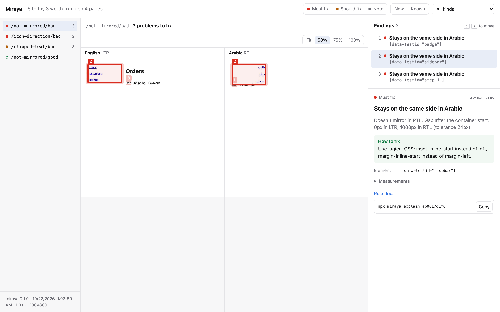

# Miraya

Finds the bugs that only exist in the right-to-left version of your web app.

Miraya opens each page in English and in Arabic in a real browser, pairs up the elements, and reports what broke when the page flipped: layouts that didn't mirror, icons pointing the wrong way, fallback fonts, clipped text, untranslated strings, scrambled phone numbers.

<picture>
  <source media="(prefers-color-scheme: dark)" srcset=".github/assets/report-dark.png">
  
</picture>

```sh
npm install --save-dev miraya @playwright/test
npx playwright install chromium
npx miraya audit
```

## Packages

| Package                                     | What it is                                          |
| ------------------------------------------- | --------------------------------------------------- |
| [`miraya`](packages/miraya)                 | The CLI, the rules and the HTML report. Start here. |
| [`@miraya/playwright`](packages/playwright) | `rtl.expectClean(page, …)` for Playwright tests.    |

## Examples

- [`examples/demo-app`](examples/demo-app): a small English and Arabic site with a Miraya config, audited in CI.
- [`examples/github-action`](examples/github-action): a workflow that fails pull requests on new RTL errors.

## Developing

This is a pnpm workspace. You need Node 22.13 or later.

```sh
pnpm install
pnpm exec playwright install chromium
pnpm build
pnpm test                              # unit tests
pnpm --filter miraya test:e2e          # renders the fixture site in Chromium
pnpm --filter @miraya/playwright test:e2e
pnpm lint && pnpm typecheck
```

`fixtures/site` is a set of small pages, one per rule, each in a good and a bad version. The end-to-end tests audit them and check that each bad page reports exactly the expected findings and each good page reports none.

## License

[MIT](LICENSE)
